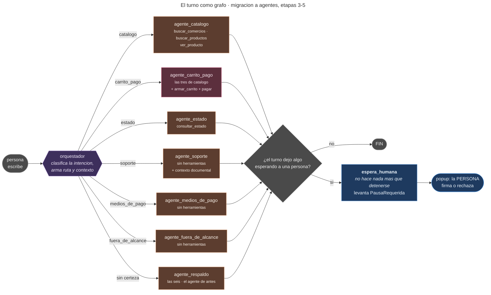
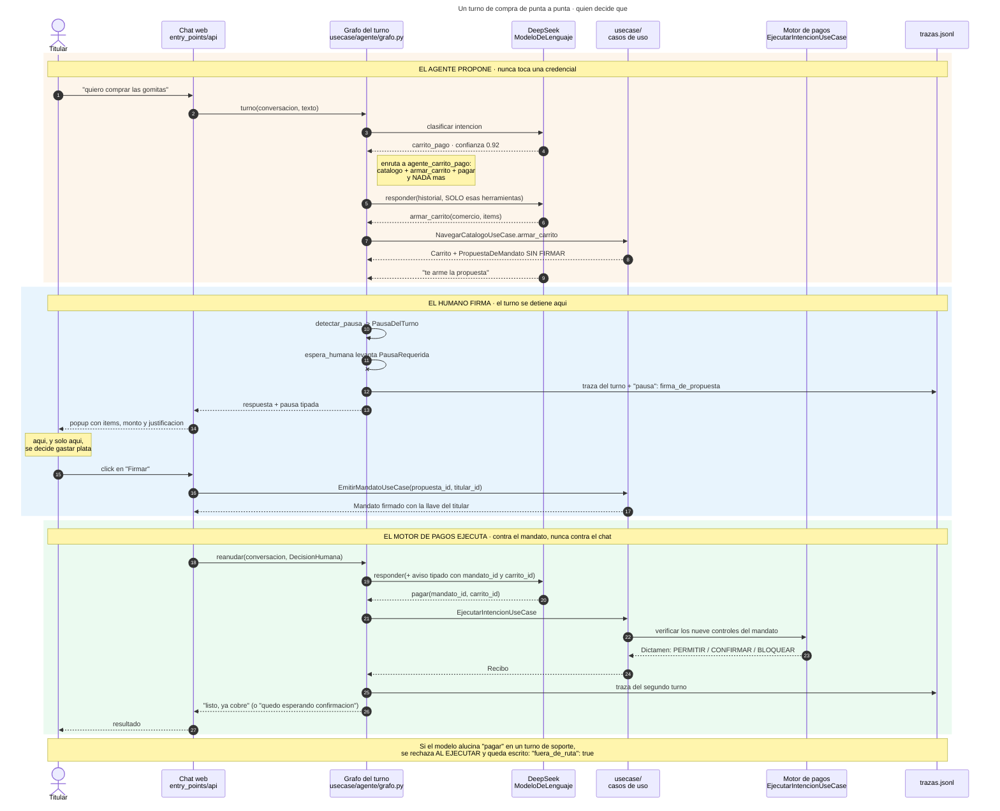
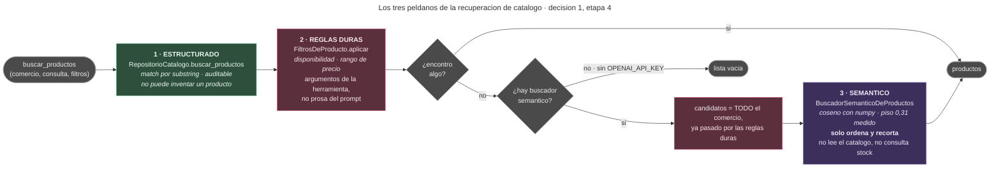

# El módulo de agentes, de un vistazo

Esta carpeta documenta `usecase/agente/` — cómo un mensaje escrito por una
persona se convierte en una respuesta, y qué puede y qué no puede hacer el
modelo en el medio. 

Los tres diagramas de
abajo estan en orden: el primero dice **qué es**, el segundo **quién decide qué**,
y el tercero explica el único mecanismo que no se adivina mirando el código.

El principio que ordena todo lo demás, y que ninguna etapa tocó:

> **El agente propone. El humano firma. El motor de pagos ejecuta.**

No es una consigna: está verificado estructuralmente. `tests/arquitectura/test_fronteras.py`
lee el AST de cada módulo y falla el build si `usecase/agente/` importa `usecase/`,
`driven_adapters/` o `entry_points/`, o si nombra `langgraph` o `langchain`. El agente
no tiene forma de alcanzar una credencial ni una pasarela, aunque alucine.

---

## 1. El turno como grafo

Un mensaje entra, el **orquestador** clasifica su intención y lo manda a uno
de siete agentes. Cada agente ve **solo** las herramientas de su dominio: el
de soporte no tiene ninguna, el de catálogo no puede cobrar, y solo
`agente_carrito_pago` —en rojo— toca dinero.

Si el turno dejó algo esperando a una persona (una propuesta sin firmar, un
cobro sin confirmar), el grafo se detiene en un nodo dedicado que no hace
nada más que detenerse.



Tres cosas que el diagrama no dice y conviene saber:

- **Un agente que recibe la ruta de otro la rechaza.** No es solo que no
  tenga la herramienta: si el grafo lo despacha fuera de su dominio, levanta
  `RutaDeOtroAgente`. Hay una prueba por intención.
- **Una herramienta alucinada se rechaza al ejecutar**, no al ofrecerla. Si
  el modelo inventa un `pagar()` en un turno de soporte, la función real
  nunca corre y queda escrito en la traza con `"fuera_de_ruta": true`.
- **`agente_respaldo` es literalmente el agente anterior a la etapa 1**, con
  las seis herramientas. Cuando el clasificador se abstiene, el turno corre
  como corría antes de toda esta migración. Ese es el piso de seguridad: la
  migración nunca deja al sistema peor que antes de empezar.

## 2. Un turno de punta a punta: quién decide qué

El mismo turno, ahora en el tiempo y con todos los actores. Las tres bandas
de color son las tres frases del principio.

Lo importante está en la banda del medio: **el turno se detiene ahí**. No es
una convención de prompt ni una nota de texto que el modelo tiene que
obedecer — es un punto del grafo del que no se sale sin que una persona haga
clic.



Notar que **el agente nunca firma**. `PROHIBIDAS` (`usecase/agente/herramientas.py`)
le niega `firmar`, `enrolar`, `revocar` y todo lo que suene a credencial, y
esa lista se valida al arrancar. El modelo pide `pagar(mandato_id, ...)` con
un id que solo existe porque una persona hizo clic; si el mandato no está,
`pagar` no tiene nada que ejecutar.

## 3. Cómo se busca en el catálogo: tres peldaños, no un RAG

El único mecanismo del módulo que no se entiende leyendo una función. Cuando
el modelo llama a `buscar_productos`, la búsqueda baja por tres peldaños y
**para en el primero que encuentra algo**.



El orden importa y es deliberado. El peldaño 1 es **auditable y no puede
inventar** un producto que no existe; el 3 es el que "entiende" pero también
el que puede equivocarse. Así que el semántico solo corre cuando el
estructurado ya falló, solo ve candidatos que las reglas duras ya
aprobaron, y **solo ordena y recorta** — no puede devolver nada que no
estuviera en la lista que recibió. Hay una prueba de exactamente eso.


## Dónde vive cada cosa

Todo esto es `usecase/agente/`, que no importa `usecase/`, `driven_adapters/`
ni `entry_points/`. Para la vista de capas completa del proyecto, ver
[`../diagramas/01-capas.mermaid`](../diagramas/01-capas.mermaid).

| Módulo | Qué hace | Etapa |
|---|---|---|
| `clasificacion/` (`reglas`, `modelo`, `cadena`) | decide la intención; las reglas primero porque son gratis | 1 |
| `nodos.py`, `intencion.py` | la lista blanca de herramientas por ruta | 1 |
| `contexto_documental.py` | inyecta documentación en turnos de soporte, sin una sola cifra | 2 |
| `grafo.py` | `EstadoDelTurno`, la definición del grafo y `AgenteEnGrafo` | 3 |
| `agentes.py` | los siete agentes especializados y su validación por nodo | 4 |
| `pausa.py` | `PausaDelTurno`, `DecisionHumana` y el aviso tipado | 5 |
| `traza.py` | un evento por turno en `trazas.jsonl` | — |
| `herramientas.py`, `politica.py`, `conversacion.py` | el catálogo, `PROHIBIDAS`, el system prompt y el loop | previas |

Los puertos que el módulo usa (`CompiladorDeGrafos`, `BuscadorDocumental`,
`BuscadorSemanticoDeProductos`, `ModeloDeLenguaje`) viven en `model/<agregado>/gateways/`, y sus
implementaciones —LangGraph, LangChain, OpenAI, numpy— en `driven_adapters/`.
`driven_adapters/orquestacion_langgraph/compilador.py` es el **único**
módulo del proyecto que importa `langgraph`.

## Los documentos

| Documento | De qué trata |
|---|---|
| [`arquitectura-agentes-langgraph.md`](arquitectura-agentes-langgraph.md) | El diseño: las ocho decisiones y el plan de cinco etapas |
| [`validacion-con-modelos-reales.md`](validacion-con-modelos-reales.md) | **La medición contra DeepSeek y OpenAI reales**, y lo que reveló |
| [`etapa-1-agentes-clasificador-de-intencion.md`](etapa-1-agentes-clasificador-de-intencion.md) | Clasificar antes de ejecutar, sin LangGraph todavía |
| [`etapa-2-agentes-soporte-rag-documental.md`](etapa-2-agentes-soporte-rag-documental.md) | El corpus de soporte y por qué no es `docs/` |
| [`etapa-3-agentes-grafo-langgraph.md`](etapa-3-agentes-grafo-langgraph.md) | El loop de turnos envuelto como nodo de un grafo |
| [`etapa-4-agentes-especializados-retrieval-hibrido.md`](etapa-4-agentes-especializados-retrieval-hibrido.md) | Los siete agentes y los tres peldaños |
| [`etapa-5-pausa-humana.md`](etapa-5-pausa-humana.md) | La pausa tipada, y por qué **no** usa `interrupt()` |

---

Los tres diagramas de arriba están además como archivo suelto en
[`../diagramas/`](../diagramas/) —`05-grafo-del-turno`,
`06-turno-con-firma-humana`, `07-retrieval-hibrido`— siguiendo la convención
que ya usan los cuatro diagramas del proyecto, para que se puedan renderizar
sueltos:

```
mmdc -i docs/diagramas/05-grafo-del-turno.mermaid -o grafo.png -b white -w 1700
```

**El archivo `.mermaid` es la copia canónica.** Si cambiás un diagrama,
cambialo ahí y pegá el resultado acá — son dos copias a propósito, para que
este documento se lea renderizado en GitHub y el diagrama siga estando donde
el resto del proyecto los busca.
